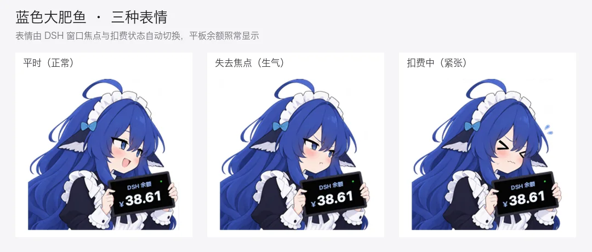

# DSH大肥鱼桌宠

一个用于 **DeepSeek Harness** 的 macOS 原生余额桌宠。角色手持平板显示余额，扣费时播放受击动画与原版音效，充值时显示提示。使用 Swift + AppKit 开发，无第三方运行时依赖。

**当前版本 v1.5.1**：支持蓝色大肥鱼、GPT龙娘、大小姐Claude、北美猫娘Gemini四个角色；蓝色大肥鱼换成表情立绘，平时开心、失去焦点生气、扣费时紧张；未连接时显示抱盆图；拖动松手吸附到最近的底部角落，左右两侧都贴紧屏幕边缘，停在右侧时立绘自动镜像；桌宠与 DeepSeek Harness 窗口绑定，DSH 窗口最小化或关闭时自动隐藏。

## 四个角色

以下为应用实际渲染的四角色拼图，使用统一示例余额，不包含真实账号信息。

<table>
  <tr><th width="50%">蓝色大肥鱼</th><th width="50%">GPT龙娘</th></tr>
  <tr>
    <td align="center" width="50%"><a href="dsh-balance-pet-macos/Resources/expression_happy.png"></a></td>
    <td align="center" width="50%"><a href="dsh-balance-pet-macos/Resources/sprite-gpt.png"></a></td>
  </tr>
  <tr><th width="50%">大小姐Claude</th><th width="50%">北美猫娘Gemini</th></tr>
  <tr>
    <td align="center" width="50%"><a href="dsh-balance-pet-macos/Resources/sprite-claude.png"></a></td>
    <td align="center" width="50%"><a href="dsh-balance-pet-macos/Resources/sprite-gemini.png"></a></td>
  </tr>
</table>

原始透明 PNG 均包含在 [`Resources`](dsh-balance-pet-macos/Resources) 文件夹中；上表图片可点击查看原图。蓝色大肥鱼的旧版单张立绘 `sprite.png` 仍保留在 `Resources` 里，仅作历史素材，应用已改用表情立绘。

**切换方法：** 右键桌宠 → 切换角色。选择立即生效，重启后自动恢复；切换保留余额、动画、窗口位置和尺寸。

蓝色大肥鱼在未配置 API Key / 账号凭证、连接中或连接失败时，改为显示抱盆图，不显示余额标题、金额、状态点或金额飘字；连接成功后自动恢复手持平板和余额显示。其他三个角色保持原有显示方式。

[](dsh-balance-pet-macos/docs/screenshots/deepseek-offline.png)

## 蓝色大肥鱼的三种表情

[](dsh-balance-pet-macos/Resources/expression_happy.png)

| 表情 | 触发条件 |
| --- | --- |
| 平时（`expression_happy.png`） | 默认状态 |
| 紧张（`expression_nervous.png`） | 发生扣费时，动画期间并额外保持 1 秒 |
| 生气（`expression_angry.png`） | DSH 窗口仍然可见、但当前前台不是 DSH 时；DSH 最小化或关闭时桌宠直接隐藏，不会显示生气 |

表情切换只换立绘，平板上的余额、飘字、受击抖动照常。表情立绘为 1024 × 1024，窗口宽度按立绘比例自动调整；其他三个角色仍是单张 1536 × 1024 立绘，不受影响。

## 更新记录

### v1.5.1 · 左右角落吸附与水平镜像

- 支持吸附到屏幕左下角或右下角：松手时看桌宠中心落在屏幕中线哪一侧，就把桌宠吸到对应的底部角落，拖过中线会自动换边。
- 吸附到右侧时立绘水平镜像，鱼始终朝着屏幕中间；平板上的余额文字保持正向可读，不会被镜像成反字，飘字也跟着挪到另一侧。
- 两侧都不再留 14 pt 的边距：吸附后立绘的最外侧像素贴住屏幕左边或右边，配合之前的贴底，贴角时三个方向都是紧贴屏幕边缘。
- 右键菜单的「松手吸附左下角 / 吸附回左下角」改为「松手吸附角落 / 吸附回最近的角落」，自动识别当前在哪一侧。
- 单击桌宠会立刻换成紧张表情，同时把立绘纵向压扁约 10%（脚不动、头往下缩），约 0.24 秒后弹回原样；按下就响应，没有等待判定单击还是拖动的延时，开始拖动时也会先缩一下。
- 新增应用图标：用 `Resources/dsh-pet-icon.png` 在构建时生成 16–1024 的 `AppIcon.icns`，Finder、系统警告框和「应用程序」里都能看到蓝毛鱼；图标源图是唯一素材，`.icns` 不入库，`verify.sh` 会校验图标存在、格式与最大/最小尺寸。
- 自检新增四个尺寸 × 四个角色的角落贴合、左右切换，以及镜像后的轮廓点击、平板文字落点和字形不翻转等回归项；另有缩头动画的幅度、时长与曲线回归项。

### v1.5.0（build 2）· 吸附贴底与仓库瘦身

- 吸附改为底部贴紧屏幕边缘，左侧仍留 14 pt 间距：窗口为了浮字在立绘下方留了 3% 的空白，原来只按窗口边框对齐，贴角后脚下悬空约 4.5 pt（150 pt 尺寸）；现在吸附时把这段空白补掉，立绘最低一行正好落在可见区域底边（Dock 在底部时就是 Dock 上沿）。
- 屏幕参数变化时的「是否还在屏内」判断同步放宽同样的内缩，避免贴底后每次插拔显示器都被判定为离屏而重新吸附。
- 修复自检里「切换立绘后绘制与新视图一致」的误报：`NSWindow` 会把内容尺寸取整到设备像素，两个视图相差 0.5 pt 导致截图永远不同；现在统一画布尺寸，四档尺寸共 12 项回归恢复通过。
- 仓库只保留 macOS 版构建需要的内容：移除 Windows 原版存档、早期 Windows 设计稿与角色生成中间产物；`verify.sh` 改为校验 `Resources/hit.mp3` 的 SHA-256，不再依赖仓库外的原版文件，文档中原有的「原版存档保留在仓库」表述改为指向上游项目。

### v1.5.0（build 1）· 蓝色大肥鱼表情立绘

- 蓝色大肥鱼换成三张表情立绘：平时开心、失去焦点生气、扣费时紧张；扣费动画结束后紧张表情再保持 1 秒。
- 表情由 DSH 窗口焦点与扣费状态自动切换，平板余额、状态点、飘字和受击抖动都保留，文字坐标按新立绘重新测量。
- 1024 × 1024 的方形立绘让窗口宽度随角色比例变化；切换到其他三个 1536 × 1024 角色时窗口自动恢复，高度和左下角锚点不变。
- 未连接时的抱盆图保持不变，按比例居中显示在方形窗口内。
- 自检新增表情渲染差异、表情切换规则与「扣费后多保持一秒」的回归项；`verify.sh` 增加三张表情图的 SHA-256 校验。

### v1.4.0 · 跟随 DSH 窗口显示

- 新增「跟随 DSH 窗口显示」，默认开启：只有 DeepSeek Harness（`com.deepseek.dsh`）有窗口显示在屏幕上时才显示桌宠。
- DSH 窗口最小化、关闭、退出或切到其他桌面空间时自动隐藏桌宠；DSH 窗口重新出现时自动恢复，不需要重启应用。
- DSH 失去焦点（切到浏览器、终端等其他 App）时桌宠保持原位，不隐藏也不移动；该联动只管显示与隐藏，不跟随窗口位置。
- 检测使用窗口服务器的在屏窗口列表，**不需要辅助功能或屏幕录制权限**；读取不到窗口列表时按「可见」处理，不会误隐藏。
- 桌宠隐藏期间不播放受击音效；右键菜单新增开关，关闭后桌宠常驻。

### v1.3.2 · 吸附左下角修复

- 修复拖动松手后不会吸附回左下角的问题；右键菜单里的「吸附回左下角」同样受影响，现已一并恢复。
- 原因：窗口动画用 `NSWindow` 的 animator 代理设置 `frameOrigin`，而这个属性不可动画，调用被静默忽略，窗口原地不动。改为动画整个 frame，并在动画结束时兜底对齐最终位置。
- 多显示器行为不变：吸附目标仍是桌宠当前所在屏幕的左下角。

### v1.3.1 · 离线抱盆状态

- 蓝色大肥鱼在未配置 API Key / 账号凭证、连接中或连接失败时，使用上方抱盆图。
- 隐藏余额标题、金额、状态点及金额飘字；连接成功后自动恢复平板图和余额。
- 透明点击区域随图片切换，其他三个角色不变。
- README 使用轻量预览图与固定尺寸的双列表格，点击图片仍可查看完整 PNG。

### v1.3.0 · 四角色切换

- 新增 GPT龙娘、大小姐Claude、北美猫娘Gemini，与蓝色大肥鱼共四个角色。
- 通过桌宠右键菜单或菜单栏即时切换，重启后保留选择。
- 切换保留余额、动画、位置及尺寸；加入四角色使用截图和透明原图展示。

## 下载与运行

前往 [最新 Release](https://github.com/Andromedahk/DSH-DaFeiYu-Desktop-Pet/releases/latest)，下载 `DSH-balance-pet-macOS-arm64.zip`，解压后将 **DSH大肥鱼桌宠.app** 放入“应用程序”并打开。

- 支持 **macOS 13 及以上**；发布版本仅包含 Apple Silicon架构。
- 应用可读取本机 DeepSeek Harness 凭证，独立运行；默认跟随 DSH 窗口显示，可在菜单里关闭该联动后单独使用。
- 应用使用本地临时签名，尚未经过 Apple 开发者签名和公证。首次打开可能被系统拦截；确认下载来源后，可在“系统设置 → 隐私与安全性”中允许打开。

## 日常操作

| 操作 | 功能 |
| --- | --- |
| 左键拖动 | 移动桌宠；默认松手吸附到最近的底部角落（左或右），可在菜单关闭 |
| 右键 / Control + 单击 | 打开菜单，切换角色、尺寸及音效等 |
| 菜单栏 ¥ | 查看余额状态、刷新余额或打开操作菜单 |
| 测试一次扣费 / 演示连续扣费 | 本地演示动画，不发起真实扣费 |

角色透明区域支持鼠标穿透，余额文字随手持平板倾斜和震动，长金额自动缩小显示。

桌宠默认与 **DeepSeek Harness 窗口**绑定：只有当 DSH 有窗口显示在屏幕上时才出现；DSH 窗口最小化、关闭、退出或切到其他桌面空间时自动隐藏，窗口回来时自动恢复。**切到别的 App 但 DSH 窗口仍然可见时，桌宠保持原位不动**，不会隐藏也不会跳动。该联动只控制显示与隐藏，不跟随窗口移动；可在右键菜单里关闭「跟随 DSH 窗口显示」。

## 从源码构建

安装 Xcode Command Line Tools 后运行：

```sh
cd dsh-balance-pet-macos
ARCH=universal ./build.sh
./verify.sh
open "dist/DSH大肥鱼桌宠.app"
```

省略 `ARCH=universal` 时只构建当前机器架构。离线验证使用独立临时配置，检查四角色资源、切换绘制、配置恢复、余额逻辑、签名和启动行为。

## 文档与来源

- [macOS 版源码与完整使用说明](dsh-balance-pet-macos/README.md)
- [代码审查与验证记录](dsh-balance-pet-macos/docs/REVIEW.md)
- [角色素材来源与文件哈希](dsh-balance-pet-macos/Resources/README.md)
- [Windows 原版项目](https://github.com/VKmich16/V)

本项目基于 [VKmich16/V](https://github.com/VKmich16/V) 的 Windows 原版移植，感谢原作者。上游 Windows 源码与素材不随本仓库分发，需要对照请查阅上游项目；本仓库只用 `dsh-balance-pet-macos/Resources/` 里的素材，缓存、编译产物及个人凭证不纳入版本控制。

上游暂未附带许可证；本仓库保留来源说明，不对上游代码和素材另行授予许可。
